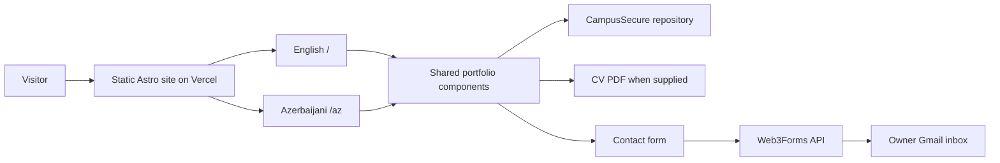

# Portfolio architecture plan

**Validated:** 2026-11-11
**Status:** Figma design and implementation phase approved on 2026-11-11. The Astro + TypeScript application is now scaffolded; see `PROJECT_STATE.md` for current implementation and verification status.

## Understanding and boundaries

- Build Hasanagha Bayramov's bilingual cybersecurity portfolio for recruiters, internship reviewers, and other visitors. Offensive Security is the primary identity.
- Use one page with Hero, About, Projects, Education, Certification, Skills, and Contact in that order. CampusSecure is the only current project and links directly to its GitHub repository; there is no project detail route for now.
- Open in English and dark mode. Provide Azerbaijani at `/az` and an optional light mode. Keep the approved responsive Figma direction and accessible controls.
- Provide a centered, simulated Terminal modal. It never executes visitor commands or calls a shell.
- Send contact submissions to `hsnagabayramov4@gmail.com` through Web3Forms. Show clear success and failure feedback in both languages.
- Deploy on Vercel's provided address without a custom domain. Put the user-supplied CV in a replaceable public asset path when available.
- Do not invent projects, credentials, experience, URLs, CV content, or screenshots.

## Operating assumptions

| Concern | Agreed planning assumption |
| --- | --- |
| Performance | Serve static HTML and load browser code only for interactive controls. Prioritize mobile speed and readable layouts. |
| Scale | Personal-portfolio traffic; new projects and certificates can be added through structured data files. |
| Security and privacy | Keep Web3Forms integration on the client as required by its standard API; collect only name, email, and message. No portfolio message database or arbitrary Terminal execution. Configure the shortest practical Web3Forms retention, targeted at seven days, and verify the actual account setting. |
| Reliability | Static content remains readable when the form provider is unavailable. Preserve form values on failure and offer the public email link as fallback. |
| Maintenance | Hasanagha primarily maintains content, translations, project links, and the CV; keep those changes localized. |

## Decisions and alternatives

| Decision | Chosen direction | Alternatives considered and reason |
| --- | --- | --- |
| Site framework | Astro + TypeScript | Next.js with a mail route adds server setup not needed for this content-focused site; a client-only Vite page would need extra work to deliver fully rendered localized content. |
| Hosting | Static Astro build on Vercel, no custom domain | A personally owned domain is outside the current plan. Astro supports static Vercel deployment without an adapter. |
| Email delivery | Browser form to Web3Forms, then owner inbox | Formspree was rejected. A custom mail endpoint adds provider/sender setup; Web3Forms is preferred by the user. |
| Localization | `/` for English and `/az` for Azerbaijani; shared page structure with separate copy | Route-based pages make each language directly linkable and keep the opening language English. |
| Theme | Dark fallback; save an explicit visitor choice locally | A theme query parameter would complicate URLs without helping this site. |
| Content | Typed local data, no CMS initially | One owner and a small number of verified items do not require a content-management service. |
| CV and project links | Replaceable `public/cv` PDF; CampusSecure links to GitHub | CV content is not yet supplied; a project detail route is not needed for the current lab. |

## Runtime flow



- Both language routes render the same section components with their own localized text. The language switch navigates between routes. The selected theme applies to both routes; without a saved choice, it is dark.
- Header, mobile menu, theme switch, back-to-top control, Terminal, and form use small TypeScript scripts. The Terminal sequence is static simulated content typed over about 10–12 seconds (target around 11), inside a visibly bordered transcript panel. Its compact Skip/Replay/Close controls and icon-labeled sound toggle are keyboard accessible. Sound starts muted and, only after the visitor enables it, uses a restrained futuristic digital keystroke effect. Skip reveals the transcript immediately, Replay restarts it, and Close stops playback. Support Escape, focus handling, and reduced-motion preferences; reduced motion shows the complete transcript without the typing delay.
- The Projects data contains real, verified projects only. The two “Coming soon” cards are presentation placeholders, not project records.
- The contact form checks required fields and email format, prevents duplicate submissions, and sends only name, email, and message to Web3Forms. Its access key is public by the provider's design; it is not treated as a secret. Spam protection begins with the provider's checks and a honeypot; add a challenge only if needed.
- A successful API response shows **“Mesaj uğurla göndərildi.”** / **“Message sent successfully.”** and clears the form. A failed response, timeout, or offline state shows **“Göndərmə uğursuz oldu. Xəta baş verdi, yenidən cəhd edin.”** / **“Message could not be sent. An error occurred. Please try again.”** Entered values remain for retry. Announce both states accessibly. An API success means the provider accepted the submission; inbox delivery is separately verified before launch.

## Proposed file tree

```text
hasanagha_portfolio/
├─ public/
│  └─ cv/                         # User-supplied PDF goes here later
├─ src/
│  ├─ pages/
│  │  ├─ index.astro              # /
│  │  └─ az/index.astro           # /az
│  ├─ layouts/SiteLayout.astro    # HTML shell, metadata, shared styles
│  ├─ components/
│  │  ├─ PortfolioPage.astro      # Approved section order
│  │  ├─ sections/                # Hero, About, Projects, Education,
│  │  │                            # Certification, Skills, Contact
│  │  └─ ui/                      # Header, footer, switches, Terminal,
│  │                               # back-to-top control
│  ├─ data/
│  │  ├─ en.ts                    # English text
│  │  ├─ az.ts                    # Azerbaijani text
│  │  ├─ projects.ts              # Verified project facts and links
│  │  └─ certificates.ts          # Verified certificate facts and links
│  ├─ lib/web3forms.ts            # Contact delivery adapter
│  └─ styles/
│     ├─ tokens.css               # Dark/light color and layout values
│     └─ global.css
├─ tests/                          # Behavior checks added with code
└─ astro.config.mjs
```

Changing a project touches `projects.ts`; changing a translation touches `en.ts` or `az.ts`; changing the CV replaces the eventual PDF under `public/cv`. Form-provider-specific code stays in `lib/web3forms.ts`.

## Verification and release gates

1. Completed: the user reviewed and accepted the current Figma visual direction and AZ copy on 2026-11-11. Carry the approved desktop/mobile, dark/light patterns into implementation and verify intermediate widths and accessibility.
2. After explicit implementation approval, build in milestones: shared layout and routes; verified content sections; interaction controls; contact integration; final visual and accessibility pass.
3. Run the build and type checks; inspect representative mobile, tablet, desktop, and wide layouts; verify links, metadata, keyboard navigation, focus behavior, and reduced-motion behavior.
4. Exercise mocked contact success, validation failure, provider failure, network failure, rate limiting, and double-submit behavior. Use the actual Vercel preview address for one end-to-end email-delivery check to the owner's inbox before launch.
5. Confirm the Web3Forms account's retention setting and that the chosen `vercel.app` subdomain is allowed. If the provider blocks it, keep the direct email link available and resolve delivery before presenting the form as working.
6. Add the real CV PDF and verify the download before publishing the CV action. Do not publish a broken or invented download.

## Open inputs

- The Web3Forms access key/account configuration and actual `vercel.app` delivery test.
- The user's current CV file and any genuine CampusSecure images. MilliSec's May 2026 start and the current AZ copy are confirmed.
- Implementation approval was given explicitly on 2026-11-11; the CV and Web3Forms access key remain open inputs.

## Sources consulted

- [Astro project structure](https://docs.astro.build/en/basics/project-structure/), [client scripts](https://docs.astro.build/en/guides/client-side-scripts/), and [Vercel deployment](https://docs.astro.build/en/guides/deploy/vercel/).
- [Web3Forms API](https://docs.web3forms.com/getting-started/api-reference), [privacy policy](https://web3forms.com/privacy), [pricing and retention](https://web3forms.com/pricing), and [hosting troubleshooting](https://docs.web3forms.com/getting-started/troubleshooting).
